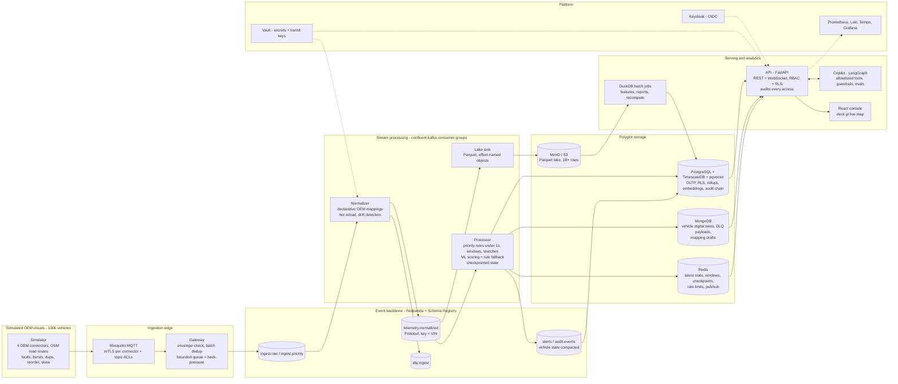
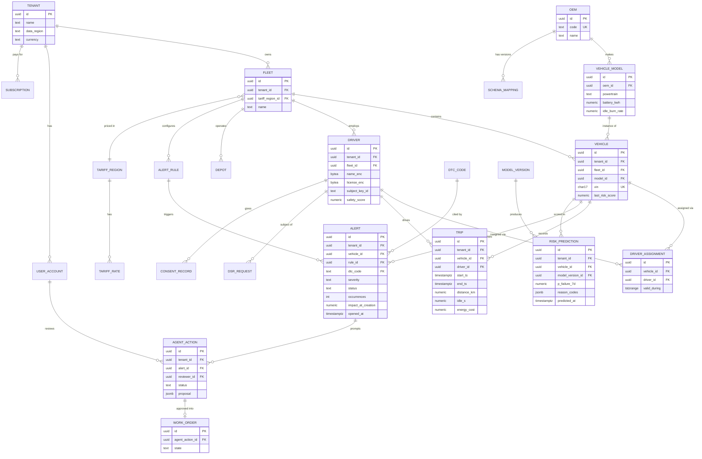

# FleetSentinel — Connected Vehicle Intelligence Platform & Copilot
### Final Solution Spec (v3) — Connected Vehicle Intelligence Hackathon (Motorq industry reference)

**Build context:** solo/small team, AI-assisted (parallel AI coding agents), **3-day window**.
**Stack:** Python backend, React/TypeScript frontend, polyglot storage, containerized, Kubernetes-ready, cloud-portable IaC.
**Source of truth for requirements:** `Motorq_Hackathon_Problem_Statement.pdf` (same folder). Every requirement in it is traced to this spec in §22.

### Labels used throughout

| Label | Meaning |
|---|---|
| **[T0]** | The brief requires it (minimum bar, technical expectations, NFRs, testing, deliverables). Never cut. |
| **[T1]** | A "wow" item: cheap relative to its judging impact. Planned, and cut only in the pre-agreed order in §24. |
| **[T2]** | Stretch. Built only if time remains. |
| **[DESIGNED]** | Specified, documented and interface-ready, but not running live. Always called out as such, never silently dropped. |

### Revision history

- **v1:** first spec.
- **v2:** revised after two adversarial reviews (technical feasibility, and completeness against the brief).
- **v3 (this version):** final research pass with a judge's eye. It fixes contradictions that both reviews missed, and it adds hero moments, meaning demo beats a judge will remember. It also moves several **[DESIGNED]** items to **[T0]/[T1]**. Some of the v3 changes *reduce* build risk (OEM-cloud batching, librdkafka, an exact dedup window, a smaller Mongo role, a single-VM cloud deployment). The full list of changes, with the reason for each, is in §25.

---

## 1. The pitch

> **FleetSentinel turns a 100,000-vehicle telemetry stream into ranked, dollar-quantified actions, typically within seconds, and proves each claim live.** One normalized pipeline answers three questions for a mixed ICE/EV fleet:
> - *Where are we losing money?* (idling, fuel and utilization)
> - *What will break next?* (predictive maintenance)
> - *Who is driving riskily, and what should change?* (driver safety)
>
> A guardrailed AI copilot turns these answers into a daily briefing of approved, audited actions.

### Why this angle (research summary)

The brief offers 8 problem spaces and allows merging them. Each was scored on three things: fit with the reference company's public direction, how many of the brief's §7 technical-expectation rows it exercises from **one** stream, and whether it can be built in 3 days.

| Problem space | Role in FleetSentinel | Why |
|---|---|---|
| Fuel, idling and utilization cost | **Core** | Clearest ROI story. Closest to the brief's own description of an AI layer that "flags excessive idling … estimates the dollar impact". |
| Predictive maintenance | **Core** | The strongest story for the "model that turns data into a decision" requirement. |
| Driver safety scoring | **Core** | Uses the same harsh-event features, so it is almost free to add. Answers "what should change" through coaching. |
| Asset recovery (lenders) | **Real feature on the priority lane** | Tow detection, going-dark and geofence alerts are the showcase for the <5 s critical-alert NFR (§8.5). |
| Multi-OEM normalization | **Platform backbone + hero moment** | A declarative mapping engine lets us onboard a new OEM live with zero downtime (§8.2). This also covers the SDV trend of "formats change more often". |
| Privacy-safe data sharing | **Real feature** | A k-anonymous insight export, plus crypto-shredding erasure (§13). |
| EV charging and battery health | **Algorithm modules** | A* reachable-charger search **[T1]** and a DP time-of-use charging schedule **[T2]**. |
| Fleet carbon reporting | **Light report [T2]** | Emission factors × fuel/energy that we already compute. One DuckDB query and one chart. |

**Why merge instead of building 8 shallow demos:** all three core outputs come from the same canonical event and the same pipeline. That gives one system at full depth instead of eight at fake depth. "Depth beats breadth" is the brief's own rule (§6).

### Hero moments (what a judge should remember; each one is scripted in the demo, §21)

1. **100,000 vehicles moving on real Bengaluru roads** on a live WebGL map, with measured ingest-to-screen latency shown on screen.
2. **A tow-away/theft alert fires in under 5 s**, with a single distributed trace from ingest to screen.
3. **A new OEM with an unknown format starts streaming, and we onboard it live.** Drift is detected, the payloads land in the DLQ, the copilot drafts a mapping, a human approves it, and the vehicles appear on the map. There is no deploy and no downtime.
4. **The copilot's daily briefing** says "5 actions save ₹X / $Y this week". Every number in it comes from a tool result (checked automatically), every action needs human approval, and the audit trail is hash-chained so tampering is detectable.
5. **Kill a Kafka broker during a 3× burst.** Consumer lag spikes and then drains, and an automated reconciliation report proves **0 events lost**.
6. **Right-to-erasure on an append-only system.** We destroy one driver's key in Vault (crypto-shredding), replay the log, and the PII comes back as unreadable ciphertext.
7. **A DuckDB query over 1 billion telemetry rows in seconds**, plus four EXPLAIN ANALYZE before/after comparisons.

### How the design follows the brief's 2026 → 2030 industry trends (brief §3)

| Brief trend | Our concrete response |
|---|---|
| Data explosion, filter at the edge | Simulated OEM connectors send compact batches. Protobuf on the wire is ~8× smaller than JSON, and the lake downsamples before cold storage (§14.3 cost table). |
| Software-defined vehicles (formats change via OTA) | Declarative mappings with versioning. Drift detection is correlated with `sw_version`. A "fault rate by software version" view. |
| Electrification | Mixed ICE/EV/hybrid simulation. SoC-aware A* charger reachability. EV-specific cost leakage (HVAC idle kWh). |
| Cloud-agnostic pressure (FleetWise closure) | A portability contract that depends only on open protocols (S3, Kafka, Postgres, Redis, OIDC). One Helm chart runs on kind locally and on a live cloud VM (§17). |
| Agentic AI | The copilot has proactive briefings, guardrails, approval gates, an evaluation harness and a full audit trail (§11). |
| Regulation (UNECE R155/R156, DPDP, GDPR) | STRIDE threat model, audit of every data access, crypto-shredding erasure, purpose-tagged access, retention enforcement (§13). |

---

## 2. Users & personas

| Persona | Primary question | Surface |
|---|---|---|
| Fleet Operations Manager | "What needs attention today and what is it costing me?" | Command Center, Copilot briefing |
| Fleet Finance / Sustainability | "Where is money leaking? What are our emissions?" | Cost and carbon reports (batch) |
| Safety / Insurance reviewer | "Which drivers are risky, and what should they change?" | Driver scorecards with coaching |
| **Lender / recovery agent** | "Where is this collateral vehicle now, and is it acting strangely?" | Recovery view (purpose-limited, audited) |
| Platform / integration engineer | "How do I onboard OEM #26 without downtime?" | OEM onboarding + data-quality console |
| Compliance auditor / DPO | "Prove the audit trail, erasure and safe sharing." | Audit viewer (chain verify), DSR, privacy export |

**Multi-tenancy [T0].** Every tenant-scoped table has `tenant_id`. Isolation is enforced in three layers:

1. **Postgres Row-Level Security** keyed on `SET LOCAL app.tenant_id`, which is set per transaction from the validated JWT. This is the hard guarantee: it holds even for a raw `psql` session or a buggy code path.
2. A repository-layer tenant filter, so the query planner still uses the `tenant_id`-leading composite indexes.
3. Tenant scope is injected server-side into every copilot tool call. It is never taken from LLM output.

---

## 3. Domain-authentic ingestion model (key v3 change)

The reference company's model is **device-free**: it pulls data from **OEM clouds** instead of installing dongles (brief §2.3). v1 and v2 had 100,000 vehicles each talking MQTT directly to us. That is less authentic, and it is the root cause of three problems: the MQTT connection explosion, per-event throughput pressure on Python, and 100k mTLS device certificates.

**v3 model:** the simulator runs **4 simulated OEM cloud connectors** (OEM A–D). Each connector owns a share of the 100k vehicles, uses its own payload format, and publishes **batches** over MQTT:

- Batch size: ~100 records or 250 ms, whichever comes first.
- Topic: `telemetry/{oem}/{shard}`, where `shard = murmur2(VIN) mod 64`. This keeps per-VIN ordering intact.
- Transport: mutual TLS with one client certificate per OEM connector, plus an MQTT ACL so each connector can publish only under its own prefix.

What this buys:

| Problem in v2 | Resolved by batching OEM connectors |
|---|---|
| 100k MQTT connections / file-descriptor limits | 4–16 connections in total |
| Python gateway work per event | Per-batch work: 100k events/s ≈ 1,000 MQTT messages/s (3,000 during a 3× burst). Mosquitto handles this easily. |
| mTLS impractical for 100k devices, so v2 marked it [DESIGNED] | mTLS for 4 connectors is realistic, so mTLS returns to **[T0] BUILD** |
| Unrealistic topology | Matches how OEM-cloud telematics platforms actually receive data |

The brief's "mTLS for devices" NFR is met at the device-facing trust boundary, which in a device-free platform is the OEM connector. **Direct-device mTLS at 100k scale** (cert issuance and rotation per vehicle) stays **[DESIGNED]**, documented as the aftermarket/legacy-hardware path used by "fleet management companies migrating from legacy hardware" (brief §2.3).

---

## 4. Architecture



### Services and their boundaries (microservices with layered internals)

| Service | Responsibility | Scales on |
|---|---|---|
| `gateway` | MQTT subscribe → envelope checks → produce raw batches to Kafka. Deliberately thin, so a burst lands in the durable log quickly. | MQTT message rate |
| `normalizer` | Raw OEM batch → canonical Protobuf events through the mapping engine. Invalid records go to the DLQ. | Consumer lag on `ingest.raw` |
| `processor` | Priority-lane rules, windowed aggregates, sketches, ML scoring, alerts, twin updates | Consumer lag on `telemetry.normalized` |
| `lake-sink` | Canonical events → Parquet on S3/MinIO | Lag |
| `api` | REST + WebSocket, authn/z, auditing, pagination, rate limits | CPU / RPS (HPA) |
| `agent` | Copilot: reactive Q&A, proactive briefings, mapping suggestions | Request rate |
| `batch` | DuckDB jobs: feature building, reports, late-event recompute, model training | Scheduled (CronJob) |
| `web` | React console | Static / CDN |
| `simulator` | OEM connectors, seed generation, ground-truth oracle | Processes, by VIN range |

Inside each Python service the layers are: `api/handlers → application services → domain (pure) → adapters (Kafka/DB)`. The pure domain layer is what makes the 80% unit-coverage gate achievable on *services* as well as algorithms (§16).

### Kafka topic design [T0]

| Topic | Key | Partitions | Retention | Format | Purpose |
|---|---|---|---|---|---|
| `ingest.raw.v1` | `oem:shard` | 64 | 3 days | raw bytes + headers | Durable landing zone. Absorbs bursts before normalization. |
| `ingest.priority.v1` | VIN | 12 | 3 days | raw record | Fast lane for critical event types (see §8.5) |
| `telemetry.normalized.v1` | VIN | 64 | 7 days | Protobuf (registry, BACKWARD compatibility) | The canonical stream: source of truth for projections |
| `vehicle.state.v1` | VIN | 64 | **compacted** | Protobuf | Latest state per vehicle, as a log-compacted snapshot |
| `alerts.v1` | VIN | 12 | 30 days | Protobuf | Alert events → Postgres, WebSocket, webhooks |
| `audit.events.v1` | tenant | 12 | 30 days, then archived to the lake | Protobuf | Every data access and every agent action |
| `dlq.ingest.v1` | OEM | 6 | 14 days | raw + error-reason headers | Failed validation or mapping. Replayable after a fix. |
| `config.mappings.v1` | OEM | 1 | compacted | JSON | Active mapping versions. Normalizers hot-reload from it. |

**Partition count:** 64 partitions gives ~1.6k events/s per partition at 100k/s, headroom for a 3× burst, and up to 64 parallel consumers. Adding partitions later remaps keys and breaks per-VIN ordering, so we provision the headroom up front (documented in ADR-02).

**Hot spots:** one tenant has 30k vehicles in the seed on purpose. Because the key is VIN rather than tenant or OEM, that tenant spreads across all partitions. A `partition_skew_ratio` metric proves it.

---

## 5. Data model

### 5.1 Relational core — 3NF [T0]



Tables not drawn, to keep the diagram readable: `SUBSCRIPTION`, `USER_ACCOUNT` (maps a Keycloak `sub` to tenant and role), `DEPOT` (approved geofences), `ALERT_RULE`, `TARIFF_REGION`/`TARIFF_RATE` (time-of-use fuel and electricity prices), `DTC_CODE` (a public generic OBD-II description lookup), `MODEL_VERSION`, `SCHEMA_MAPPING` (versioned, immutable once active), `CHARGER`, `DSR_REQUEST`, `CONSENT_RECORD`, and `AUDIT_LOG`. `AUDIT_LOG` is append-only and hash-chained. It deliberately has **no FKs**, so audit rows outlive user deletion.

**3NF notes:**
- Model-level attributes (battery capacity, idle burn rate) live in `VEHICLE_MODEL`, not `VEHICLE`. This removes the transitive dependency VIN → model → capacity.
- OEM is its own table. v2 stored it as a free-text column while calling it a "lookup".
- Driver-to-vehicle history lives in `DRIVER_ASSIGNMENT` with a `tstzrange` and an exclusion constraint, so one vehicle cannot have two drivers at the same time.

**Documented denormalizations (brief §8):**

| Column | Why it is stored | Consistency |
|---|---|---|
| `VEHICLE.last_risk_score`, `DRIVER.safety_score` | Cached projections that save a join and an aggregation on every dashboard read | Eventually consistent, ≤ 60 s. Rebuildable from the log. |
| `ALERT.impact_at_creation` | A point-in-time fact, deliberately not recomputed when tariffs change later | Immutable |
| Trip aggregates | Derived facts stored to serve reads | Recomputed nightly from the lake |

**Index plan.** These are also the before/after cases in §9.3.
- `alert (tenant_id, status, opened_at DESC) WHERE status IN ('open','ack')`: a partial composite index.
- `trip (tenant_id, vehicle_id, start_ts DESC, id)`: supports keyset pagination.
- `risk_prediction (tenant_id, predicted_at DESC)`.
- Timescale `telemetry_1m`: hypertable on `bucket`, with compression `segmentby = vehicle_id` and `orderby = bucket DESC`.
- pgvector HNSW indexes on the embedding tables.

Encrypted PII columns (`*_enc`) hold Vault Transit ciphertext (§13.3).

### 5.2 Polyglot storage — which data lives where, and why [T0]

| Store | Holds | Why this store | CAP posture |
|---|---|---|---|
| **PostgreSQL + TimescaleDB** | OLTP entities, RLS, alerts, predictions, 1-min rollups as a hypertable plus continuous aggregates, the audit chain | ACID for ownership, billing, RBAC and audit. Timescale adds time partitioning and compression, so the hot tier needs no second engine. | CP |
| **pgvector** (in Postgres) | (a) **Telemetry-signature vectors** (32-dim per vehicle-day) for "vehicles that look like vehicles that failed"; (b) text embeddings of the DTC knowledge base and resolved incidents, used for copilot retrieval | Two real vector use cases, and both need joins to tenant-scoped relational data under the same RLS | CP |
| **MongoDB** | (a) **Vehicle digital twins**: one document per vehicle whose shape varies by powertrain and OEM (EV battery block, ICE fuel block, OEM extras), upserted at most once per 5 s per vehicle; (b) DLQ payload quarantine with reasons, for inspection and replay; (c) mapping drafts and sample payloads for onboarding | Genuinely schema-variable documents that are read whole by the Vehicle 360 view | AP-leaning (single node in the demo) |
| **Redis** | Latest vehicle state for the map, window state and **checkpoints** (AOF on), rate-limit buckets, WebSocket fan-out pub/sub, HyperLogLog counters, short-TTL caches | Sub-millisecond reads for anything happening "right now" | AP, ephemeral, rebuildable |
| **Redpanda** | The event log: source of truth and replay | See ADR-01 | Replicated log |
| **MinIO / S3 + Parquet** | Full-fidelity history (the lake), with Hive partitions `date=/oem=/vehicle_shard=` | Cheap columnar storage and the S3 API gives cloud portability | Strong read-after-write (S3 and MinIO) |
| **DuckDB** (engine, not a store) | Batch analytics over **1B+ lake rows**: model features, reports, late-event recompute | Columnar SQL over Parquet with no cluster to run (ADR-03) | — |

**v3 correction:** v2 put "raw + normalized telemetry" in MongoDB. At 100k events/s that is ~8.6 billion documents a day, which is exactly the single-database failure the brief warns about (§4.1). Full-fidelity telemetry now lives **only** in Kafka and the lake. Mongo holds twins (100k upserted documents), the DLQ, and a 0.1% raw sample with a 72-hour TTL index for debugging.

---

## 6. Simulator and seed dataset [T0 — "the simulator itself is part of your solution"]

### 6.1 Realism

- **Roads [T1]:** a public OpenStreetMap extract of Bengaluru (ODbL, attributed) is pre-processed offline once into a **library of ~5,000 drivable routes** and committed as a compressed artifact. Vehicles follow these polylines with speed profiles by road class, so the live map shows traffic on real streets rather than random-walk noise.
  *Fallback:* a synthetic city grid (§24).
- **Fleet mix:** 100,000 vehicles in 50 tenants with power-law fleet sizes (one 30k-vehicle tenant to test hot spots). Powertrains are 60% ICE, 30% EV, 10% hybrid across 4 OEMs. Every VIN is valid under ISO 3779, with a correct check digit.
- **Behaviour:** a per-vehicle Markov model with shift schedules: parked → driving → idling → charging (EVs), plus depot returns.
- **Injected faults and noise (all counted in ground truth):**
  - 3× bursts at shift start
  - ~2% out-of-order events and ~1% duplicates, both per-record and whole-batch retries
  - GPS jumps and a stuck-speed sensor
  - odometer rollback (a fraud or tamper signal)
  - clock skew (+/- minutes)
  - vehicles going dark
  - tow events (movement while ignition is off)
  - unapproved-depot clustering
  - a **schema-drift event**: OEM D starts sending an unregistered format mid-demo
- **Non-leaky maintenance ground truth.** Each vehicle has a hidden, continuous wear state `w(t)`: a random walk with shocks that is independent of every label. DTC emission probability and the SoC-degradation rate are stochastic functions *of* `w(t)`. Breakdowns come from a hazard process on `w(t)` with jittered delay. Features may only use data with `ts < prediction_ts`, and a check in the training pipeline enforces this. Evaluation reports two held-out splits: temporal and by-VIN (§10.1).

### 6.2 The simulator is also the test oracle [T1]

Every injected incident (tow, crash, going-dark, depot cluster, impending breakdown) is written to a `ground_truth` Parquet file. This lets us score the **entire alert pipeline** for precision, recall and latency against known truth, not only the ML model. Very few teams can say "our end-to-end alerting has 97% recall at p95 3.1 s against injected incidents", and we can prove it (§16).

### 6.3 Seed profiles (one command: `make seed`) [T0]

| Profile | OLTP | Lake (Parquet) | Target time |
|---|---|---|---|
| `lite` (default, for laptops) | 50 tenants, 100k vehicles, ~120k drivers, 30 days of trips (~9M rows), ~2M alerts | 100M telemetry rows (7 days at 1 per ~6 min) | < 10 min |
| `full` (the demo / "billions of rows" proof) | same | **~1.0B rows** (100k vehicles × 7 days × 1 per min) ≈ 15–25 GB of zstd Parquet | ~30–45 min, vectorized generation (numpy/pyarrow) |

A 100k-vehicle seed is required by brief §13, and **100,000 vehicles are simulated in every profile and every run.** Only the per-vehicle event frequency changes. This keeps the minimum bar ("≥100,000 vehicles") literally met even on a laptop.

---

## 7. Canonical event and wire format [T0]

The canonical event is **Protobuf**, registered in Redpanda's built-in Schema Registry with BACKWARD compatibility, and the compatibility check runs in CI (§16). The brief names Avro/Protobuf for IoT ingestion. v2 used JSON everywhere.

```protobuf
message TelemetryEvent {
  string vin = 1;             // validated ISO 3779
  int64  ts_ms = 2;           // event time, UTC
  int64  seq = 3;             // per-VIN monotonic when the OEM provides it
  double lat = 4; double lon = 5;
  float  speed_kmh = 6;
  optional float soc_pct = 7;       // EV / hybrid
  optional float fuel_pct = 8;      // ICE / hybrid
  double odo_km = 9;
  repeated string dtc = 10;          // validated ^[PBCU][0-9A-F]{4}$
  EventType evt = 11;                // HARSH_BRAKE, HARSH_ACCEL, IGNITION_ON/OFF, TOW, CRASH, ...
  bool ignition = 12;
  string sw_version = 13;            // SDV / OTA tracking
  string oem = 14;
  int64 ingest_ts_ms = 15;           // set by the gateway; used for end-to-end latency metrics
  bytes driver_ref_enc = 16;         // Vault-encrypted driver link; PII is never plaintext in the log
}
```

Size: JSON is ~1 KB per event. Protobuf is ~100–130 B, and zstd batch compression brings that to ~30–40 B on the broker. This is the basis of the cost model in §14.3.

The DTC regex accepts hex digits in positions 3–5 because real codes such as `P0A80` use them. v2's `[0-9]{4}` pattern rejected valid codes.

---

## 8. Ingestion and real-time processing

### 8.1 Gateway (thin on purpose) [T0]

The gateway does only the following:
1. Accept a batch over MQTT (QoS 1, mTLS identity checked against the topic ACL).
2. Validate the envelope (size ≤ 1 MB, known OEM, record count).
3. Deduplicate retried batches: a **Bloom filter is used as a negative filter only**. A "not seen" answer is trusted. A "maybe seen" answer is confirmed against an exact Redis `SET` with a TTL. So a Bloom false positive costs one extra Redis lookup and **can never drop valid data**, which fixes the v2 flaw.
4. Produce the batch to `ingest.raw.v1` using the idempotent producer (`enable.idempotence=true`, `acks=all`, zstd).
5. Scan the batch cheaply with the OEM mapping's `priority_selector` and copy critical records to `ingest.priority.v1`.

**Back-pressure [T0]:**
- The path runs through a bounded `asyncio.Queue` (10k batches).
- When the queue is full, the MQTT client stops acknowledging and reading, so Mosquitto's per-client inflight and queue limits push back on the connector. The connector then buffers and retries with jittered backoff.
- The metrics `gateway_queue_depth` and `gateway_backpressure_seconds_total` are on the pipeline dashboard.
- If Redpanda is unreachable, a bounded on-disk spill buffer holds batches, and replay happens in order once Redpanda is back.

**Precise loss boundary:** once the gateway has acknowledged a batch, no data is lost. That guarantee holds through `acks=all`, the idempotent producer and the spill buffer. The only window where loss is accepted is connector → gateway, and it is bounded by QoS 1 retries. The reconciliation test in §15 proves the whole path.

### 8.2 Normalizer and the declarative OEM mapping engine [T0 + T1 hero moment]

v2 said a new OEM needs "one adapter + one registry row, no redeploy". That is contradictory: an adapter is code, so it needs a deploy. In v3, **mappings are data**, interpreted by a generic, safe engine (ADR-05):

```yaml
oem: OEM_B
version: 3
envelope: { records: "$.d[*]" }
fields:
  vin:       { path: "$.v",      transform: [upper, validate_vin] }
  ts_ms:     { path: "$.t" }                                    # epoch ms
  lat:       { path: "$.la" }
  lon:       { path: "$.lo" }
  speed_kmh: { path: "$.sp_mph", transform: [{ mul: 1.609344 }] }
  fuel_pct:  { path: "$.fl" }
  dtc:       { path: "$.codes",  transform: [split_csv, validate_dtc] }
  evt:       { path: "$.ev",     transform: [{ enum_map: { HB: HARSH_BRAKE, HA: HARSH_ACCEL, TW: TOW, CR: CRASH } }] }
priority_selector: { path: "$.ev", in: [TW, CR] }
drop_unmapped: true   # data minimisation: unknown fields never enter the platform
```

- **Transforms** come from a fixed allowlist: rename, unit conversion, epoch → UTC, enum maps, split, validators. There is no `eval`, so a mapping cannot run arbitrary code (a STRIDE tampering control).
- **Lifecycle:**
  1. Draft (Mongo).
  2. Validate against the stored sample payloads, with a side-by-side preview of normalized output in the UI.
  3. Approve.
  4. Activate: publish to the compacted `config.mappings.v1` topic, and every normalizer hot-reloads within about 2 s.
  5. Replay the OEM's DLQ records through the new mapping, so onboarding does not lose the events that arrived before the mapping existed.
- **Drift detection:** per-OEM validation-failure rate, unknown-field detection, and a correlation with `sw_version`. A failure spike raises an alert such as "Schema drift: OEM_D, 100% unmapped since 10:42, new `sw_version` 5.2".
- **Copilot-drafted mappings [T1]:** the agent receives synthetic sample payloads plus the canonical schema and proposes a mapping YAML. The engine validates it against the samples. It is **never auto-activated**; a human approves it. This is the demo's hero moment #3.
- **Hand-written adapters:** three example OEM formats ship as mappings: nested (OEM_A), flat-abbreviated with mph and epoch (OEM_B), and the brief's illustrative shape (OEM_C). OEM_D is onboarded live.

### 8.3 Processor state: effectively-once, checkpointed [T0]

Consumers use **confluent-kafka** (librdkafka, C). It is several times faster than pure-Python clients, and that matters at 100k/s. Faust was already dropped in v2; see the decision log in §19.

State lives in-process per partition (dicts and numpy arrays) for speed. Every 5 s per partition, the processor checkpoints:
1. It writes aggregates, dedup windows and `last_offset` to Redis atomically, in one `MULTI/EXEC` pipeline.
2. It then commits the Kafka offset.

On a rebalance or crash, the new owner restores the snapshot and seeks to `last_offset + 1`. This is per-partition, barrier-style checkpointing, the same idea as Flink's, and it gives **effectively-once state updates** on top of at-least-once delivery.

**Idempotent sinks:** every derived record has a deterministic ID, so re-emitting it after a replay is harmless:

| Record | Deterministic ID | Sink behaviour |
|---|---|---|
| Alert | `uuid5(vin, rule_id, window_start)` | Postgres `ON CONFLICT DO NOTHING` |
| Trip | `uuid5(vin, start_ts)` | Same |
| Lake object | `topic/partition/startOffset-endOffset.parquet` | A rewrite after a crash replaces an identical object. S3/MinIO PUTs are atomic, so readers never see partial files. This replaces v2's "atomic rename", which is a filesystem idea that doesn't map to object stores. |

### 8.4 Deduplication and time semantics [T0]

- **Record dedup is exact. It is not probabilistic.** Sequence numbers are monotonic per VIN, so each VIN keeps an **anti-replay sliding window**: the maximum `seq` seen plus a 64-bit bitmap, the same algorithm IPsec and DTLS use. Each check is O(1) time with no false positives, and the window costs ~16 B per VIN, which is **~1.6 MB for 100k vehicles**.
  - For OEMs that don't send `seq`, the key falls back to `(vin, ts_ms, content-hash)`, checked through the Bloom-then-exact path from §8.1.
  - v2's Bloom filter on this path could silently drop valid data. The Bloom filter now appears only where it belongs, and the report compares both approaches with their complexity (§9).
- **Event-time windows:**
  - Each partition keeps a watermark equal to the maximum event time seen minus 10 s of allowed lateness.
  - An event later than that does **not** update the real-time window. It is counted in `late_events_total`.
  - It still lands in the lake, and the nightly DuckDB recompute corrects the stored aggregates.
  - The result: streaming is fast and approximate, batch is authoritative, and nothing is lost. This fixes v2's "late events are dropped".
- **Clock skew:** an event more than 2 minutes in the future is sent to the DLQ with reason `CLOCK_SKEW`.
- **GPS plausibility:** a jump implying more than 250 km/h is discarded from position (kept for the data-quality metrics), and a stuck sensor is flagged. Per-OEM data-quality scores appear in the Platform console [T1].

### 8.5 Two lanes: critical alerts in under 5 s even during a burst backlog [T0]

**v3 fixes a real contradiction.** v2 computed alerts in 60 s tumbling windows with 10 s grace, so a critical alert could take **~70 s**. That breaks the "critical alert < 5 s" NFR by 14×. It also means a burst backlog would delay critical alerts behind bulk telemetry.

| Lane | Input | Logic | Target |
|---|---|---|---|
| **Priority** | `ingest.priority.v1` (own consumer group, never backlogged behind bulk traffic) | Stateless or tiny-state rules per event: **TOW** (movement while ignition is off), **CRASH** (deceleration threshold or crash event), **GEOFENCE_BREACH** after hours (lender collateral), **CRITICAL_DTC** (a severity list), **LOW_SOC_STRANDING** (SoC below the energy needed for the nearest reachable charger, via A*) | p99 < 5 s from event, ~1 s typical |
| Priority (timer) | Last-seen time per VIN | **GOING_DARK**: no data for N minutes, detected with a **hierarchical timing wheel** (O(1) insert and expire) instead of scanning 100k vehicles | Within 1 s of the deadline |
| **Bulk** | `telemetry.normalized.v1` | 60 s event-time windows: idling and cost leakage, harsh-event rates, ML features and scoring, depot clustering (every 5 min), Count-Min top-K DTCs | Freshness ≤ 60 s (not a critical path) |
| **Live map** | `vehicle.state` → Redis → WebSocket | Latest position per VIN, pushed as 1 Hz deltas | p95 ingest → screen < 2 s |

**Alert lifecycle [T0]:**
- States: `open → acknowledged → resolved`, or auto-resolved when the condition clears.
- Deduplication and suppression: a repeat of an open `(vehicle, rule)` pair increments `occurrences` instead of creating a new alert. Each rule has a cooldown.
- Severity routing sends alerts to WebSocket, and to HMAC-signed webhooks **[T2]**.

This keeps alert fatigue down, and a real operator would expect it.

### 8.6 Graceful degradation [T0]

| Failure | Degraded behaviour | Visible as |
|---|---|---|
| ML model fails to load or throws | Scoring falls back to the rule baseline (`active DTC → high`) | A `model_fallback_active` metric and a banner in the UI |
| LLM provider down or no API key | The copilot is disabled. The rest of the platform works fully, and a **rules-generated briefing** still lists the top $ opportunities. | A copilot status pill |
| Bulk lane lagging (burst) | The priority lane is unaffected. The map shows a **data-freshness indicator** instead of silently showing stale data. | Freshness badge in the header |
| Postgres slow | Consumers `pause()` their partitions (pull-based back-pressure). API circuit breakers return a fast 503 with `Retry-After`. | Breaker-state metric |
| Mongo down | The twin view falls back to the Redis latest state plus Postgres | Partial-data badge |

---

## 9. Algorithms and data structures — with complexity [T0: brief §9 and the "algorithms write-up with complexity analysis" deliverable]

### 9.1 Algorithm catalog

| Area (brief §9) | Algorithm | Where used | Complexity | Why this and not the alternative |
|---|---|---|---|---|
| Regex / parsing | VIN validation: regex `^[A-HJ-NPR-Z0-9]{17}$` plus the ISO 3779 check digit (transliteration and weights, mod 11) | Simulator, normalizer, API input | O(1) | Regex alone accepts invalid VINs |
| Regex / parsing | DTC parser `^[PBCU][0-9A-F]{4}$` → system, generic/manufacturer, subsystem | Normalizer, knowledge base | O(1) | — |
| Regex / parsing | Mapping-engine JSONPath subset + transform pipeline | Normalizer | O(fields) per record | Safe, declarative, no `eval` |
| Streaming | **Anti-replay sliding window** (exact dedup) | Processor | O(1) time, ~16 B per VIN | Exact, unlike a Bloom filter |
| Streaming | **Bloom filter** as a negative filter before an exact check | Gateway batch dedup | O(k) per check. FP rate `(1−e^{−kn/m})^k`, sized for ≤1% at 1M batch IDs per hour → m ≈ 9.6 bits/item, k = 7 | Skips an exact lookup for the ~99% of batches that are new |
| Streaming | **Count-Min Sketch + min-heap** | Fleet-wide top-K DTCs per OEM and model | O(d) update, O(log K) heap. ε = e/w, δ = e^{−d}; w = 2,048 and d = 5 give ≤0.13% overcount with 99.3% confidence | Exact counts would need per-code, per-model state across the whole fleet |
| Streaming | **HyperLogLog** (Redis `PFADD`) | Distinct active vehicles per geohash-5 cell per hour, feeding the heatmap and the **k-anonymity suppression** in the privacy export | O(1), ~12 KB per counter, ~0.81% error | An exact distinct count per cell would cost O(n) memory |
| Streaming | Event-time tumbling windows + watermarks | Processor bulk lane | O(1) per event | — |
| Streaming | **Hierarchical timing wheel** | GOING_DARK detection | O(1) insert and expire | Scanning 100k last-seen timestamps would be O(n) per tick |
| Spatial | **Geohash** (precision 7 ≈ 153 m, 5 ≈ 4.9 km), with the 9-cell neighbourhood | Depot clustering, map aggregation at low zoom, privacy generalization | O(1) encode | Fast bucketing without a spatial database on the hot path |
| Graph | **Union-Find** connected components over idle vehicles in adjacent geohash-7 cells | Unapproved-depot cluster detection (asset misuse) | O(n α(n)) | BFS would also work; Union-Find is incremental and near-linear |
| Graph | **A\*** with an admissible haversine heuristic on the OSM road graph, edges constrained by SoC | Nearest *reachable* charger; the LOW_SOC_STRANDING rule | O((V+E) log V) worst case, far fewer expansions than Dijkstra in practice | We benchmark both in the write-up and show the node-expansion counts |
| Dynamic programming | **Optimal trip/stop segmentation** with PELT-pruned changepoint DP (penalized cost) | Batch trip reconstruction, which corrects the online segmentation | O(n²) naive, ~O(n) expected with PELT pruning | Online, a hysteresis state machine gives O(1) per event (fast, approximate); DP is the authoritative batch answer |
| Dynamic programming | **Time-of-use charging schedule** over 15-minute slots × SoC levels, minimizing cost subject to departure SoC **[T2]** | EV scheduling panel | O(T·S·A) | A greedy "cheapest slots" approach ignores charge-rate taper and power limits |
| Online state machine | Trip start/stop with hysteresis | Processor | O(1) per event | Sub-second trip state; DP corrects it in batch |

Every algorithm lives in `libs/fscore/algorithms`. Each one has unit tests plus **Hypothesis property-based tests**, for example: a VIN with a correct check digit always validates; dedup never drops a unique `(vin, seq)` pair; CMS never undercounts; segmentation cost never exceeds the naive baseline.

### 9.2 SQL optimisation write-up: four cases, before/after EXPLAIN ANALYZE [T0]

All four techniques the brief names get their own measured before/after. v2 had two cases and hand-waved the N+1 one.

| # | Query | Before | After (technique) |
|---|---|---|---|
| 1 | Open-alerts queue per tenant | Seq scan with a sort over ~2M alerts | **Partial composite index** `(tenant_id, status, opened_at DESC) WHERE status IN ('open','ack')` |
| 2 | Fleet cost summary (30 days) | Aggregation over ~9M trips on every request | **Materialized view / Timescale continuous aggregate** with scheduled refresh |
| 3 | Trip history deep page | `OFFSET 200000` scans and discards rows | **Keyset pagination** on `(start_ts, id)` |
| 4 | Vehicle list with alert counts | A deliberately naive ORM version runs 1 + N queries through lazy loading | A single query with `selectinload` or an explicit join. We report the query count and the latency. |

**Bonus finding for the write-up:** RLS predicates interact with index choice. The policy uses `current_setting('app.tenant_id')::uuid`, which is stable within a statement, so the `tenant_id`-leading indexes are still used. We show the plan to prove it.

---

## 10. Machine learning and vector layer [T0: "a model that turns data into a decision, evaluated against a baseline"]

### 10.1 Predictive maintenance: from model to decision

- **Model:** a LightGBM classifier with isotonic calibration. LightGBM has built-in `pred_contrib` (SHAP values), so every prediction gets **reason codes** without an extra dependency.
- **Features:** built by DuckDB over the lake. This ties the batch layer directly to ML.
  - DTC frequency and recency by system
  - harsh-event rate
  - SoC-degradation slope and charge-efficiency drift
  - km since last service
  - idle ratio
  - `sw_version` age
- **Baselines:** (1) the rule `active DTC → high risk`; (2) logistic regression.
- **Metrics:** reported on a **temporal split and a by-VIN held-out split.** A random row-level split is never used.

| Metric | Why it matters |
|---|---|
| PR-AUC | Failures are rare. ROC-AUC flatters imbalanced data. |
| **Precision@K**, where K = daily service-bay capacity | A fleet can only inspect K vehicles per day |
| Brier score and a calibration plot | Probabilities drive dollar math, so they must be calibrated |
| **Expected $ saved** | The actual decision metric |

- **The decision:** for each vehicle, `EV = p × C_breakdown − C_inspection`, where the costs come from the tenant's configuration. The recommended inspection list is the top K by EV with EV > 0. This is literally "a model that turns data into a decision". The copilot presents this list and the dollar value.
- **Honesty controls:**
  - A **robustness curve** re-trains and evaluates at 3 simulator noise levels and shows how both the model and the baseline degrade.
  - A **model card** (`docs/model-card.md`) states that results are on synthetic data and prove the pipeline and method, not real-world efficacy.
  - Each prediction carries its `model_version_id`, for auditability.

### 10.2 Driver safety score (explainable by construction)

- The score is a weighted formula normalized **per 100 km of exposure**, so long-haul drivers aren't penalized for driving more.
- It is adjusted for night share and road class, and drivers below a minimum exposure get a "low confidence" badge.
- Inputs: harsh braking and acceleration per 100 km, time over the speed limit, night driving, idling-while-assigned.
- **"What should change"** (the brief's own question) is answered with coaching: the one or two behaviours that contribute most, as a peer-percentile delta (for example, "harsh braking 3.1/100 km vs fleet p50 of 1.2 → the biggest improvement lever").
- We chose explainable over a black-box model because the scores feed HR and insurance decisions (decision log §19).

### 10.3 Cost leakage and savings opportunity

- Leakage = idle hours × the model's idle burn rate × the regional tariff (fuel or kWh). EVs use HVAC idle kW.
- **Opportunity** = leakage above the fleet's peer-p25 benchmark. This is the "we can save $X" number on the Command Center.
- Burn rates and tariffs are configurable. Defaults are taken from public government guidance (for example, US DOE idling-fuel guidance), and every figure is cited in the Solution Document.

### 10.4 Vector layer: two justified uses [T0: "vector storage where useful, justified"]

1. **Look-alike risk [T1]:** each vehicle-day becomes a 32-dimensional normalized signature (the feature vector). A pgvector HNSW index answers "which vehicles look like vehicles that broke down within 7 days?". This is a kNN over pre-failure signatures that complements the classifier and powers the agent tool `find_lookalike_vehicles`. Target latency is < 50 ms under RLS.
2. **Knowledge retrieval:** the public generic OBD-II DTC descriptions plus synthetic resolved-incident notes are embedded locally with `all-MiniLM-L6-v2` (384-dim). No external embedding API is used, so it's private and portable. The copilot uses this to explain "P0301 = cylinder 1 misfire; common causes …".

---

## 11. Agentic AI — Sentinel Copilot [T0 + T1]

### 11.1 Capabilities

- **Reactive Q&A:** "Why is vehicle X flagged?", "Which depot wastes the most on idling?"
- **Proactive daily briefing [T1]:** runs on a schedule or on demand. It ranks opportunities across cost, maintenance and safety by expected dollar value, writes a briefing, and creates **pending** `AGENT_ACTION` rows. This is the "monitors → flags → recommends → estimates $" loop the brief describes.
- **Mapping drafts** for onboarding a new OEM (§8.2).

### 11.2 Tools

All tools are server-side, tenant-scoped, read-only, and have schema-validated arguments:

`get_fleet_summary`, `get_vehicle(vin)`, `list_alerts(filters)`, `explain_risk(vin)` (reason codes), `find_lookalike_vehicles(vin)`, `estimate_impact(alert_id)`, `search_knowledge(query)`, `run_report(report_id, params)` (predefined DuckDB reports only, **never free-form SQL**), `propose_action(...)` (writes a *pending* proposal only), `draft_mapping(oem, samples)`.

### 11.3 Guardrails, mapped to the OWASP Top 10 for LLM Applications

| Risk | Control |
|---|---|
| Prompt injection, direct or via data (for example, an OEM free-text field) | Tool outputs are passed as data blocks, never as instructions. OEM free-text is stripped by `drop_unmapped`. A red-team evaluation set tests this (§11.4). RLS is the final backstop. |
| Sensitive information disclosure | **Pseudonymization before the LLM:** driver identities become opaque tokens. Locations are generalized to geohash-6 unless the purpose requires more. Tokens are re-identified only in the UI, and only for authorized roles. |
| Excessive agency | Read-only tools. The only write is `propose_action`, which creates a proposal in `pending`. A human approves it, and only then does it become a `WORK_ORDER`. Approval carries an idempotency key. |
| Improper output handling / hallucination | **A numeric grounding check:** every number in the final answer must appear in a tool result from that turn. Otherwise the answer is regenerated once, and then shown with a "could not verify" flag. |
| Unbounded consumption | At most 8 tool calls per turn, a 30 s timeout, a per-tenant daily token budget, and a rate limit of 20 requests per minute per user |
| Malformed tool calls | Re-prompt with the validation error, at most 2 times. Then fall back to a templated answer that links the raw records. |

**Audit:** every prompt, tool call (with arguments), tool result hash, final answer, approval and rejection goes to `audit.events` and on to the hash-chained audit log (§13.4).

**LLM provider:** pluggable through configuration. The default is any hosted tool-calling model through a provider abstraction; a local model through Ollama is available as the optional `ai-local` profile **[T2]**. The model and provider in use are declared in the Solution Document. Without a key, the system degrades as described in §8.6.

### 11.4 Agent evaluation harness [T1]

The brief asks for AI that is "evaluated", and judges rarely see it done for agents.

| Evaluation set | Contents | What is measured |
|---|---|---|
| Golden set | 30 questions with ground-truth answers computed from the simulator oracle | Tool-selection accuracy, answer correctness, numeric-grounding rate |
| Red-team set | 12 adversarial prompts: cross-tenant requests, injected instructions inside payloads, "approve this yourself", SQL requests | Refusal and block rate; this must be 100% for any cross-tenant data leak |

The harness runs on demand (LLM calls cost money and are non-deterministic), and a committed report sits in `docs/evidence/`. CI runs the guardrail logic against a **stubbed LLM** on every push.

---

## 12. API and web console

### 12.1 API [T0]

- **Framework and contract:** FastAPI with SQLModel/SQLAlchemy, using explicit loading strategies and no implicit lazy loads. It is versioned under `/v1`, the **OpenAPI spec is contract-first** in `contracts/openapi.yaml`, and errors use **RFC 9457 Problem Details**.
- **Pagination:** keyset with an opaque cursor, a maximum page size of 200, and a whitelist of filter and sort fields.
- **Rate limits:** Redis token buckets per tenant (1,000/min), per user (300/min) and for the copilot (20/min). Responses are `429` with `Retry-After` and include `RateLimit-*` headers.
- **Idempotency:** POSTs that change state (approve action, DSR request, mapping activation) require an `Idempotency-Key`.
- **Live data:** a WebSocket at `/v1/stream`. The token goes in the first message, never in the query string, so it can't leak into logs. The server pushes 1 Hz deltas of map positions for the viewport. At low zoom it sends geohash-aggregated counts instead of 100k points. Positions are packed binary (Float32Array) rather than JSON.
- **Response models:** explicit pydantic response models, which block excessive data exposure and mass assignment.
- **Circuit breakers:** around Postgres, Mongo, the agent and DuckDB report calls (closed → open → half-open).

**OWASP API Security Top 10 (2023) mapping [T0]:**

| Risk | Control | Verified by |
|---|---|---|
| API1 Broken Object-Level Authorization (BOLA) | RLS + tenant filter | BDD test: tenant A cannot read tenant B's VIN (§16) |
| API2 Broken authentication | Keycloak OIDC; RS256 pinned; `iss`/`aud`/`exp`/`nbf` checked; JWKS cached with rotation | Unit and integration tests |
| API3 Broken object-property-level authorization | Response models, role-based field masking (location precision by role) | Contract tests |
| API4 Unrestricted resource consumption | Rate limits, page caps, a 1 MB body limit, query timeouts, agent budgets | k6 abuse scenario |
| API5 Broken function-level authorization | Per-route role guards, deny by default | Route-matrix test |
| API6 Sensitive business flows | Action approval is rate-limited, idempotent and audited | BDD |
| API7 SSRF | Webhook URL allowlist; no user-supplied fetch URLs | Unit test |
| API8 Security misconfiguration | Security headers, strict CORS, no debug in production images | ZAP baseline in CI |
| API9 Improper inventory management | Versioned OpenAPI; schema diff in CI | CI |
| API10 Unsafe consumption of APIs | OEM payloads validated by the mapping engine; LLM output grounding-checked | Unit tests + evals |

**Privacy-safe insight export [T1]:** `GET /v1/insights/export` returns tenant aggregates with location generalized to geohash-5 and **k-anonymity suppression**: any cell with fewer than 10 distinct vehicles (HyperLogLog count) is suppressed. The response contains no VINs or driver identifiers. It answers the brief's "share insights without exposing personal data" with a real mechanism.

### 12.2 Web console [T0 "usable web interface" + T1 polish]

- **Stack:** React, Vite and TypeScript; Tailwind with shadcn/ui; TanStack Query.
- **Map:** **deck.gl** (WebGL, handles 100k+ points smoothly) on **MapLibre GL** with a **self-hosted PMTiles** Bengaluru basemap. There is no map API key and no external tile dependency, so it works offline and on any cloud.
- **Charts:** ECharts.
- **Auth:** OIDC Authorization Code + PKCE through Keycloak.

| Screen | Contents |
|---|---|
| **Command Center** | KPI strip: $ leaking today, savings opportunity this week, at-risk vehicles, open critical alerts, **measured p95 ingest-to-screen latency, and data freshness**. Live map of 100k vehicles (colour by status, idling heatmap toggle). Live alert feed. |
| **Vehicle 360** | Twin document, trip timeline, risk with reason codes, look-alike vehicles, DTC explanations, recommended action |
| **Drivers** | Exposure-normalized scores, confidence, coaching levers |
| **Copilot** | Chat, daily briefing, approval queue (approve/reject with reason) |
| **Platform** | OEM onboarding (mapping editor + live preview + activate), DLQ explorer with replay, data quality per OEM, schema drift |
| **Compliance** | Audit log viewer with a **"verify hash chain"** button, DSR/erasure console, privacy-export preview |

Every screen has role-based views and designed empty, loading and error states. The console meets WCAG AA contrast and is keyboard-navigable.

---

## 13. Security and compliance

### 13.1 Authentication and identity [T0]

- **Users:** Keycloak OIDC (Authorization Code + PKCE) with realm roles `platform_admin`, `fleet_admin`, `analyst`, `viewer`, `lender_agent`. The tenant comes from a user attribute mapped into a token claim.
- **Service-to-service:** client-credentials JWTs.
- **OEM connectors:** **mTLS client certificates** from a project CA generated by a script, with one certificate per connector and topic ACLs. This is back to **[T0] BUILD** (see §3).
- **Transport:** TLS 1.3 minimum on the ingress (Traefik) and on MQTT. In-cluster service mesh mTLS (Linkerd) is **[DESIGNED]**.
- **Secrets:** Vault. Services authenticate with the Kubernetes auth method in K8s and a dev token in compose. There are no secrets in images or in git, and **gitleaks** runs in CI.

### 13.2 Encryption at rest (AES-256) [T0]

- **Cloud path:** S3 SSE-KMS and KMS-encrypted EBS volumes (AES-256), both provisioned by Terraform.
- **Application level:** PII columns are **envelope-encrypted with Vault Transit** (`aes256-gcm96`) under **one key per data subject**. That per-subject key is what makes crypto-shredding possible (§13.3).

### 13.3 Right to erasure in an event-sourced system: crypto-shredding [T0 + T1 hero moment]

**v3 fixes a hidden contradiction.** v2 claimed event sourcing ("replay the log to rebuild projections") and also claimed erasure by "tombstoning across stores". Those two claims conflict: replaying an immutable log would **bring the erased PII back**, and v2 could not delete from Kafka history or immutable Parquet.

**Fix (ADR-04):**
- Driver PII and the driver link are only ever written **encrypted under that driver's key**, both in Postgres and inside events (`driver_ref_enc`).
- **The erasure flow:**
  1. Verify the request (`DSR_REQUEST`).
  2. **Destroy the subject's key in Vault.**
  3. Null out the Postgres PII columns and the Mongo/Redis projections.
  4. Trips stay for fleet analytics but are **pseudonymized**: they can no longer be linked to the person.
  5. Produce an evidence report and an audit entry.
- Every copy in the Kafka log, the lake and backups is now unreadable ciphertext. A replay renders it as `[erased]`. This is proven in the compliance test suite (§16).
- **Scope of personal data, stated precisely:**
  - Vehicles are fleet-owned assets, so VIN telemetry on its own is company data.
  - It becomes personal data when linked to a driver. That link lives only in `DRIVER_ASSIGNMENT` and in `driver_ref_enc`.
  - Precise location trails for a driver's trips are **masked by role** (viewer: geohash-6) and **purpose-tagged** (for example, the `RECOVERY` purpose unlocks precise location for a `lender_agent`, but only for a vehicle flagged in default). Every such access is audited.

### 13.4 Audit of every data access [T0]

The brief requires "audit logs for **every data access** and AI-agent action". v2 only audited agent actions.

- An API middleware emits an audit event for **every request**: actor, tenant, route, resource IDs, purpose, allow/deny decision, and latency.
- The agent emits one for every step.
- Events flow through `audit.events` into the append-only Postgres `AUDIT_LOG`. `UPDATE` and `DELETE` are revoked, and a trigger rejects them.
- **Tamper evidence:** `hash = SHA-256(prev_hash ‖ canonical_row)`. A daily anchor hash is written to an **object-locked (WORM) bucket** (S3 Object Lock, or MinIO object lock locally).
- A `/v1/audit/verify` endpoint and a UI button verify the chain. The compliance test edits a row directly in the database and shows that verification fails.
- **Volume:** audit events are per API request, not per telemetry event. That's ~hundreds per second, well within Postgres capacity.

### 13.5 Retention enforcement and DPDP/GDPR mapping [T0]

**Retention is configuration, enforced by each store's own mechanism, and tested:**

| Store | Mechanism |
|---|---|
| Kafka | `retention.ms` per topic |
| Timescale | `add_retention_policy` |
| S3/MinIO | Lifecycle rules (Standard → IA → Glacier, then expire) |
| Mongo | TTL indexes |
| Audit log | 7 years |

| DPDP (2023, Rules notified Nov 2025) / GDPR principle | Implementation |
|---|---|
| Notice, consent, lawful basis | `CONSENT_RECORD` per driver, with purpose and timestamp |
| Purpose limitation | A purpose tag on every sensitive access, stored in the audit log |
| Data minimisation | `drop_unmapped: true`. Pseudonymization before the LLM. Aggregate-only export. |
| Rights: access, correction, erasure | A DSR console and API; export of a subject's data; crypto-shredding erasure |
| Storage limitation | The retention policies above |
| Breach notification | A runbook, **[DESIGNED]** |
| Data residency | `TENANT.data_region` routes the lake prefix. Multi-region deployment is **[DESIGNED]**. |

### 13.6 STRIDE threat model [T0: deliverable]

Scheduled for Day 1, 1 hour, before the build pile-up. The output is `docs/security/stride.md`: a table of the 6 STRIDE categories across 6 trust boundaries, each threat with a control and a test reference.

| Trust boundary | Example threat and control |
|---|---|
| OEM connector → MQTT | Spoofing → mTLS + ACL. Tampering → envelope validation. DoS → back-pressure and size limits. |
| Gateway → Kafka (internal) | Tampering → SASL/ACLs **[DESIGNED]** |
| Browser → API | Spoofing → OIDC + PKCE. Elevation → RBAC + RLS. Information disclosure → field masking. |
| Agent → LLM provider (external) | Information disclosure → pseudonymization. Tampering → grounding check. |
| Admin / mapping activation | Elevation → `platform_admin` role only, approval step, audited; no code execution in mappings |
| Data stores | Repudiation → hash-chained audit. Information disclosure → encryption, crypto-shredding. |

It also cross-references where **UNECE R155/R156** apply: we are a cloud platform, not a vehicle, but the OEM-connector boundary and the software-version visibility support an OEM's cybersecurity and software-update management system obligations.

**Supply chain [T0/T1]:** Semgrep (SAST), Trivy (filesystem and images), pip-audit and npm audit, gitleaks, a **Syft SBOM** attached to the release, base images pinned by digest, and non-root, read-only-root-filesystem containers. Cosign image signing is **[T2]**.

---

## 14. System design

### 14.1 The ten named principles (brief §10), each mapped to a mechanism

| Principle | Mechanism |
|---|---|
| Partitioning and sharding | Kafka keyed by VIN (64 partitions); Timescale time chunks + `segmentby vehicle_id`; lake partitioned by date/OEM/vehicle_shard; a skew metric |
| Replication | `ha` profile: 3-node Redpanda, RF = 3, `min.insync.replicas = 2`; 2+ replicas of every stateless service. Postgres primary + replica via CloudNativePG in K8s is **[T2]**; in compose it is single-node, a known residual risk (§26). |
| Idempotency | Idempotent producer; exact anti-replay dedup; deterministic IDs + `ON CONFLICT`; offset-named lake objects; `Idempotency-Key` on POSTs |
| Exactly-once vs at-least-once | At-least-once delivery everywhere, made **effectively-once** through checkpointed state + idempotent sinks. We state why we don't use Kafka transactions: they add latency, and cross-store exactly-once (Kafka → Postgres/Redis) isn't covered by them anyway. |
| Back-pressure | Bounded gateway queue + MQTT flow control; pull-based consumers with `pause()`; the spill buffer |
| Circuit breakers | API → Postgres/Mongo/agent/DuckDB; agent → LLM provider |
| CQRS and event sourcing | The command side is the ingest path into the log. The query side is Postgres, Mongo and Redis projections. **`make replay` rebuilds projections from the log into a fresh schema** (a live proof). The long-term event archive is the lake, beyond Kafka's 7 days. Crypto-shredding keeps this compatible with erasure. |
| Cache invalidation | Event-driven: an alert or state change publishes an invalidation for the affected keys, with a TTL backstop of 60–120 s. The WebSocket state is authoritative for the map. |
| Horizontal scaling | Stateless services; consumers scale up to the partition count; **scaling measured at 1/2/4 instances** (§15); KEDA lag-based autoscaling **[T2]** |
| Graceful degradation | §8.6 table |

### 14.2 CAP / PACELC by data class

| Data | CAP | PACELC (when no partition: latency vs consistency) | Reason |
|---|---|---|---|
| Billing, subscriptions, RBAC, ownership, audit | **CP** | EC: synchronous commits | A wrong grant or a wrong charge is a correctness bug |
| Telemetry log | AP at the edge (the connector buffers); in-cluster acks=all with ISR = CP-ish | EL for the gateway path; producers batch (linger ~5 ms) | Moving vehicles must never block; the loss boundary is precise (§8.1) |
| Derived alerts, scores, twins | AP + idempotent replay | **EL**: a 2-second-stale score is fine | Rebuildable projections |
| Map and latest state (Redis) | AP | EL | Freshness is displayed, and staleness is visible |

### 14.3 Data lifecycle with a retention and cost estimate [T0; missing entirely in v2]

**Assumptions:**
- 100k vehicles × 1 event/s = 8.64B events/day
- Parquet with zstd ≈ 25 B/event, which gives **~216 GB/day**
- 1-min rollups: 144M rows/day at ~30 B ≈ 4.3 GB/day
- Prices are indicative AWS us-east-1 list prices, to be re-verified at submission

| Tier | Store | Resolution | Retention | Steady-state size | ≈ Monthly cost |
|---|---|---|---|---|---|
| Hot | Timescale (compressed) + Redis | 1-min rollups + latest state | 7 days | ~30 GB | ~$5 on gp3 (compute excluded) |
| Log | Redpanda | full, Protobuf + zstd (~35 B/event) | 7 days, RF 3 | ~0.3 TB/day × 7 × 3 ≈ 6.3 TB | ~$500 on gp3 |
| Warm | S3 Standard-IA, Parquet | full fidelity | 13 months | ~85 TB | ~$1,070 (S3 Standard would be ~$1,960) |
| Cold (as designed) | S3 Glacier Deep Archive | **downsampled to 1-min rollups** | 7 years (or the tenant's policy) | ~11 TB | **~$11** |
| Cold (the naive alternative) | Glacier Deep Archive | full fidelity | 7 years | ~552 TB | ~$546 |

**Headline:** steady-state storage costs about **$1.6k per month for 100k vehicles, which is ~$0.016 per vehicle per month.** Downsampling before cold storage cuts cold cost by ~50×. Compared with raw JSON (8.6 TB/day, from the brief), Protobuf plus columnar storage cuts the warm footprint by ~40×.

The spreadsheet behind this table, with formulas, ships in `docs/cost-model.md` so judges can check the arithmetic.

### 14.4 SLOs [T1]

| SLO | Target | Error budget |
|---|---|---|
| API availability | 99.9% | 43.8 min/month |
| Ingest-to-screen freshness | p95 < 2 s | — |
| Critical alert latency | p99 < 5 s | — |
| API latency | p95 < 200 ms, p99 < 500 ms | — |

These are Prometheus recording and alert rules shown on a Grafana SLO dashboard.

### 14.5 Observability: centralized logs, metrics and traces [T0]

- **The stack:** the Grafana LGTM stack: Prometheus (metrics), **Loki** (logs), **Tempo** (traces), Grafana. We chose Loki over ELK because label-indexed logs are far cheaper at high volume than full-text indexing, and that's the right trade-off for a large event stream.
- **Tracing across Kafka:** the W3C `traceparent` is carried in Kafka headers. Sampling is **1% head sampling for bulk batches, and 100% for priority-lane events and alerts.** So a critical alert shows one trace from MQTT receipt → normalizer → rule → Postgres → WebSocket push. That trace is demo hero moment #2.
- **Logs:** structured JSON (`structlog`) with a PII-redaction processor. There is **no per-event logging**: at 100k events/s, logging each event would itself become a big-data problem. We log per batch, errors, and sampled data. That design choice is worth stating in the write-up.
- **Dashboards:**
  - Pipeline: rate, lag, end-to-end latency histograms, late events, DLQ rate
  - SLOs
  - Data quality per OEM
  - Security: authorization denials, rate-limit hits
  - Agent: tool calls, tokens, guardrail blocks

---

## 15. NFR validation plan: target vs evidence [T0]

| NFR (brief §11) | Target | How we prove it | Evidence artifact |
|---|---|---|---|
| Throughput | Sustain 100k+ events/s | The simulator acts as the calibrated load generator. The **definitive run is on the cloud VM** (16 vCPU; it costs a few dollars, see §17) at **the full 100k/s**. We also measure the scaling curve at 1/2/4 normalizer and processor instances. If the full rate is not reached, we report the measured number and the curve honestly. | `docs/evidence/load/*.html`, Grafana snapshots |
| 3× burst for 5 min, no data loss | 300k/s for 5 min | Burst scenario → the raw topic absorbs it → lag peaks and drains → **reconciliation job**: for every VIN, compare sent `seq` ranges (from the simulator's ledger) with persisted ranges in the lake. The report lists gaps (expected: 0), duplicates removed, and late-arriving counts. | `reconciliation-report.json` |
| Latency | Ingest → screen < 2 s; critical alert < 5 s; API p95 < 200 ms and p99 < 500 ms | Prometheus histograms `e2e_ingest_to_ws_seconds` and `critical_alert_latency_seconds` (clocks are same-host or NTP-synced); k6 at 300 RPS mixed traffic against the API; oracle-measured alert latency | k6 summary and Grafana |
| Scalability | Adding nodes needs no code change | Change the replica count only (Helm values); the curve above | Scaling table |
| Availability | No single point of failure; recovers after a broker or pod is killed | Chaos in the `ha` profile: kill 1 of 3 brokers during load (**0 loss via reconciliation**), kill a processor replica (rebalance plus checkpoint restore), kill an API pod (the Kubernetes probes recover it) | Chaos report and video clip |
| Security | Full list in §13 | ZAP, Trivy, Semgrep, gitleaks reports; BOLA tests; the STRIDE document | `docs/evidence/security/` |
| Compliance | Audit, masking, retention, erasure | Compliance suite (§16) | Test report |

**Soak test:** 1 hour at 50% load. Pass criteria: memory stays flat, lag stays bounded, and there is no drift in end-to-end p95.

---

## 16. Testing strategy (heavily weighted in the brief; everything runs in CI) [T0]

| Type | What | Gate |
|---|---|---|
| **Unit** | pytest across `libs/fscore` (algorithms, mapping engine, domain) **and** each service's application and domain layers; Vitest for web logic | **Coverage ≥ 80% on the core packages, enforced in CI with `--cov-fail-under=80`**. I/O adapters are excluded from unit coverage and covered by integration tests. v2 only promised 80% on algorithms; the brief says "core services and algorithms". |
| **Property-based [T1]** | Hypothesis tests for VIN, DTC, dedup window, CMS bounds, geohash round-trip, and the mapping engine | Part of the unit suite |
| **Integration** | Testcontainers: Redpanda, Postgres with Timescale and pgvector, Redis, Mongo, MinIO. Covers the full ingest → normalize → process → store path, **RLS isolation**, and the checkpoint-restore path. | On PRs to main |
| **Contract** | (1) **Pact:** `web` (pact-js consumer) → `api`, and `agent` → `api` tool endpoints (pact-python). (2) **Schema contracts:** `buf breaking` plus a Schema Registry BACKWARD compatibility check for the Protobuf events shared by gateway, normalizer, processor and sink. | PRs to main; the schema check runs on every push |
| **Acceptance (BDD, `behave`)** | Five features: maintenance alert with dollar impact and reason codes; copilot briefing → approval → work order → audit entry; tenant isolation (BOLA); live OEM onboarding without downtime; erasure makes replayed PII unreadable | PRs to main |
| **End-to-end oracle [T1]** | A 15-minute simulated run with injected incidents. Asserts alert recall ≥ 95% and precision ≥ 90% per critical rule, and a p95 latency threshold. | Nightly |
| **Performance** | k6 for API load, the simulator for ingest throughput and bursts, and the soak test (§15) | Nightly/manual on the cloud VM, with reports committed |
| **Security** | Semgrep, gitleaks, pip-audit and npm audit on every push. Trivy (images) + SBOM on PRs. **OWASP ZAP baseline + API scan** (from the OpenAPI spec) against the compose stack on PRs to main. | Fail on high-severity findings |
| **Compliance** | Erasure through crypto-shredding (replay shows `[erased]`); audit hash-chain tamper detection; retention policies applied; "every request is audited" (the count of requests equals the count of audit rows) | PRs to main |
| **Chaos** | Broker kill (`ha` profile), processor-replica kill, API-pod kill, ML-model kill (fallback), LLM kill (degrade) | Scripted; run nightly and for the demo |
| **Agent evaluations** | The golden and red-team sets (§11.4); guardrail logic runs against a stubbed LLM in CI | Guardrail tests on every push; full evaluation on demand |
| Mutation testing **[T2]** | `mutmut` on `libs/fscore/algorithms` | Report only |

**CI pipeline (GitHub Actions):**

| When | Steps |
|---|---|
| Every push | Lint and type-check (ruff, mypy, eslint, tsc) → unit + coverage gate → Semgrep, gitleaks, pip-audit/npm audit, `buf breaking` → guardrail tests |
| PR to main | Integration → contracts → BDD → compliance → build images → Trivy + SBOM → ZAP against the compose stack |
| Nightly / manual | Oracle end-to-end, load, soak and chaos on the cloud VM; agent evaluations |

Reports are published as artifacts and to GitHub Pages, which provides the "CI pipeline link" deliverable.

---

## 17. DevOps and deployment

### 17.1 Local: one command [T0]

`make up` runs `docker compose --profile core up` and then `make seed`. The compose file has profiles:

| Profile | Contents | Approx. RAM |
|---|---|---|
| `core` (default) | Redpanda ×1, Postgres+Timescale+pgvector, Mongo, Redis, MinIO, Mosquitto, Keycloak, Vault (dev), all services, web | ~8 GB |
| `obs` | Prometheus, Loki, Tempo, Grafana with dashboards | +1.5 GB |
| `ha` | Redpanda ×3 (RF 3), 2× api / normalizer / processor | +3 GB |
| `ai-local` **[T2]** | Ollama with a small tool-calling model | +6 GB |

Hardware requirements are listed in the README. Health-gated startup ordering means nothing races. A realm export pre-configures Keycloak, so there is no manual console setup.

### 17.2 Kubernetes [T0]

- **One Helm umbrella chart** for all services, the same chart for kind (local) and for the cloud VM (k3s).
- Liveness and readiness probes that check real dependencies (DB connectivity, consumer-lag thresholds).
- Resource requests and limits, PodDisruptionBudgets, and HPA on CPU for `api`. **KEDA** scaling on Kafka lag for the normalizer and processor is **[T2]**.
- Default-deny **NetworkPolicies** with explicit allows between services.
- `securityContext`: non-root, read-only root filesystem, dropped capabilities.
- Vault secret injection (Agent Injector) in K8s.

### 17.3 Terraform and live cloud deployment [T0; upgraded in v3]

v2 applied only an S3 bucket and an RDS instance, then destroyed them. That proves very little. It was also **wrong on a detail: AWS RDS does not support the TimescaleDB extension**, so the "reference" stack could never have run our schema.

**v3 has two stacks:**

1. **`infra/terraform/aws/live` — BUILD and APPLIED [T0].**
   - Provisions a VPC, one EC2 VM, an S3 bucket (SSE-KMS) plus an **object-locked audit-anchor bucket**, security groups, and a DNS name (or the public IP with a sslip.io hostname).
   - Cloud-init installs **k3s** and `helm install`s the **exact same chart** used on kind.
   - The VM is c6i.4xlarge (~$0.68/h) for the load and chaos tests, then m6i.xlarge (~$0.19/h) for the judging window. That's roughly **$15–25 in total**, with a budget alarm set.
   - Result: **a live HTTPS URL that judges can click**, with Let's Encrypt certificates through Traefik.
   - `terraform destroy` runs after judging.
2. **`infra/terraform/aws/reference` — [DESIGNED], `plan`-validated.**
   - The production shape: EKS, MSK (Kafka API), ElastiCache (Redis), S3.
   - Postgres + Timescale runs **in-cluster via CloudNativePG**, or on Timescale Cloud. This is not RDS, and the reason is stated.
   - MongoDB runs in-cluster or on Atlas.

**Portability contract [T0: "no code changes needed for another cloud"]:** the application depends only on open protocols, configured through environment variables:

| Dependency | Protocol | AWS | GCP | Azure |
|---|---|---|---|---|
| Object store | S3 API | S3 | GCS (XML/S3-compatible interoperability API) | Blob via an S3 gateway, or MinIO in-cluster |
| Event log | Kafka API | MSK / Redpanda | Managed Kafka / Redpanda | Event Hubs (Kafka endpoint) / Redpanda |
| Relational | Postgres wire + Timescale + pgvector | CloudNativePG / Timescale Cloud | same | same (Azure Flexible Server supports TimescaleDB, with feature caveats) |
| Cache | Redis | ElastiCache | Memorystore | Azure Cache |
| Identity | OIDC | Keycloak (any cloud) | same | same |
| Compute | Kubernetes + Helm | EKS / k3s | GKE | AKS |

The proof of "no code changes" is that the same images and the same Helm chart run on local kind and on the AWS VM, and only values differ. We don't claim that a second cloud was deployed live.

---

## 18. Repository layout

```
fleetsentinel/
  contracts/        proto/ (buf), openapi.yaml, mappings/ (OEM_A..C yaml), topics.yaml
  libs/fscore/      algorithms/, sketches/, geo/, vin/, dtc/, mapping_engine/, domain/
  services/         gateway/ normalizer/ processor/ lake_sink/ api/ agent/ batch/
  simulator/        connectors/, routes/ (OSM-derived artifact), faults/, oracle/, seed/
  ml/               features.sql, train.py, evaluate.py, model-card.md
  web/              React app
  deploy/           compose/ (profiles), helm/fleetsentinel/, keycloak-realm.json
  infra/terraform/  aws/live, aws/reference, modules/
  tests/            integration/ contract/ bdd/ e2e_oracle/ load/ chaos/ compliance/ evals/
  docs/             adr/ (5), decisions.md, security/stride.md, sql-writeup.md,
                    algorithms.md, cost-model.md, evidence/, solution-document/
```

---

## 19. Architecture Decision Records: exactly 5 (brief: "3–5") plus a decision log

v2 said the brief asks for "3–5 as a minimum" and submitted 6. That misreads the brief. v3 submits **exactly five** formal ADRs, in `docs/adr/`, and puts every other decision in a lightweight log.

| ADR | Decision | Main consequence |
|---|---|---|
| **ADR-01** | **Redpanda (Kafka API) with its built-in Schema Registry and Protobuf on the wire.** Rejected: Apache Kafka + ZooKeeper/KRaft (operational weight for 3 days); JSON on the wire (~8× larger, no schema evolution). | Code stays portable to MSK or Confluent unchanged; ~8× less bandwidth and storage |
| **ADR-02** | **VIN-keyed partitioning with 64 partitions, plus a separate priority lane.** Rejected: keying by tenant or OEM (hot spots); a single lane (critical alerts would wait behind the bulk backlog). | Per-VIN ordering and even spread. Cross-vehicle aggregates need a fan-in. Partition headroom is chosen up front. |
| **ADR-03** | **Lake + DuckDB for batch (billions of rows); Timescale continuous aggregates for hot rollups; no Spark.** Rejected: Spark/Flink (cluster operations outweigh the benefit at this scale). | Same SQL-over-Parquet surface. A real Spark migration would still need a table format such as Iceberg for catalog, schema evolution and time travel. That is stated honestly and not claimed as a "config change". |
| **ADR-04** | **Crypto-shredding for right-to-erasure in an event-sourced system.** Rejected: rewriting Kafka and lake history (infeasible on immutable logs); tombstones only (a replay brings PII back). | Erasure is provable and immutability is preserved. Cost: per-subject key management through Vault. |
| **ADR-05** | **A declarative, data-driven OEM mapping engine, not code adapters.** Rejected: per-OEM Python adapters (every new OEM means a deploy). | Onboarding without downtime and live. Mappings can't execute code. The transforms are limited to the allowlist. |

**Decision log (`docs/decisions.md`):**
- confluent-kafka (librdkafka) consumer groups over Faust or aiokafka
- pgvector over Qdrant
- an explainable safety score over a learned ranker
- Keycloak over a hand-rolled JWT issuer
- a single-VM k3s cloud deployment over partial managed services
- MapLibre + PMTiles over tile APIs that need keys
- Loki over ELK
- per-connector mTLS over per-device mTLS
- exact anti-replay dedup over Bloom-only dedup
- LightGBM over RandomForest (native SHAP)

---

## 20. Solution Document plan (the template is not in the folder)

The brief's deliverables mention a "provided template", but it is not in the working folder. It still has to be obtained (§23). In the meantime, the Solution Document is drafted in `docs/solution-document/` **section by section in the brief's own order (§1–§14)**, so whatever shape the template takes, every required topic already exists as a block that can be moved into it:

- Problem framing
- Industry context and trends
- Architecture
- Data engineering
- Algorithms
- System design
- NFR evidence
- Testing evidence
- Security and compliance
- DevOps
- Rules and declarations
- References

**References:** the brief's table of contents lists "16. References", but the 10-page PDF doesn't include that section. We cite our own sources: OpenStreetMap (ODbL), generic OBD-II DTC descriptions, emission factors, government idling-fuel guidance, and cloud pricing pages.

---

## 21. Demo video storyboard (≤ 5:00) [T0]

It is recorded against fixed, rehearsed prompts and scenario triggers, and edited from segments. Every number on screen comes from the live system.

| Time | Beat | Proves |
|---|---|---|
| 0:00–0:20 | The problem in numbers: 100k vehicles, 8.6 TB/day raw, what "trustworthy in seconds" means | Framing |
| 0:20–1:00 | Command Center: live WebGL map of 100k vehicles on Bengaluru roads; KPI strip showing $ leaking and savings; freshness p95 shown | Real-time, UI, scale |
| 1:00–1:35 | Trigger a tow scenario: alert in about 1–2 s; lender recovery view; the Tempo trace from ingest to screen | Critical alert < 5 s, observability |
| 1:35–2:25 | Copilot daily briefing: "5 actions, $X/week"; "why is VIN … flagged?" → reason codes, look-alikes, DTC explanation; approve → work order → **verify the audit chain** | ML decision, vector, agent guardrails, audit |
| 2:25–3:05 | OEM_D starts streaming an unknown format → drift alert and DLQ → the copilot drafts a mapping → preview → approve → vehicles appear, DLQ replayed, **no deploy** | Multi-OEM normalization, zero downtime |
| 3:05–3:45 | 3× burst plus kill a broker: lag spikes then drains; **reconciliation: 0 lost** | Throughput, availability, idempotency |
| 3:45–4:20 | DuckDB over **1B rows** in N s; four EXPLAIN ANALYZE before/after (ms → ms) | Big data, SQL optimization |
| 4:20–4:45 | Erasure: the key is destroyed, replay shows `[erased]`; k-anonymous export | Privacy and compliance |
| 4:45–5:00 | CI green, coverage %, ZAP/Trivy clean, **live cloud URL**, architecture diagram | Engineering rigour, deployability |

---

## 22. Traceability: every requirement in the brief → where it is met

| Brief requirement | Where in this spec | Tier |
|---|---|---|
| ≥100k vehicles, own simulator | §3, §6 | T0 |
| Real time + batch analytics | §8, §9, ADR-03 | T0 |
| Relational + NoSQL + vector, each justified | §5.2, §10.4 | T0 |
| Secure APIs + usable web interface | §12, §13 | T0 |
| Containerized, tested, cloud-deployable, no code change for another cloud | §16, §17 | T0 |
| IoT ingestion: bursty, out-of-order, duplicate; idempotent, schema-validated, back-pressure-aware; MQTT; Protobuf | §3, §6, §7, §8 | T0 |
| Durable partitioned streams with replay | §4 topics, §14.1 (`make replay`) | T0 |
| Detection within seconds + batch over billions of rows | §8.5, §6.3 (1B rows), §9.2 | T0 |
| Paginated, rate-limited APIs | §12.1 | T0 |
| ML model → decision, against a baseline | §10.1 | T0 |
| Agent with guardrails + audit trail | §11, §13.4 | T0 |
| Centralized logs, metrics, traces | §14.5 | T0 |
| Microservices, IaC, CI/CD, cloud-agnostic | §4, §16, §17 | T0 |
| 3NF + documented denormalization | §5.1 | T0 |
| Partition telemetry by time and vehicle; hot-spot-free keys | §4, §5.1, §14.1 | T0 |
| EXPLAIN ANALYZE before/after (index, materialized view, keyset, N+1) | §9.2 | T0 |
| Graph, DP, regex/parsing and streaming algorithms | §9.1 | T0 |
| CAP/PACELC per data class | §14.2 | T0 |
| The 10 named principles | §14.1 | T0 |
| Hot/warm/cold with retention **and cost estimate** | §14.3 | T0 |
| Microservices + layered internals + ADRs | §4, §19 | T0 |
| NFRs: throughput, latency, scalability, availability, security, compliance | §15, §13 | T0 |
| Unit ≥ 80% (services and algorithms), integration (Testcontainers), contract (Pact), BDD, load (k6) + soak, SAST/DAST/dependency/image scans, compliance + chaos | §16 | T0 |
| Deliverables: Solution Document, repo + README + one-command setup + 100k seed, architecture + ER + 3–5 ADRs, end-to-end demo, test evidence, DevOps pack + STRIDE, algorithms + SQL write-up, ≤5-minute video | §20, §17, §5, §19, §21, §16, §13.6, §9 | T0 |
| Rules: synthetic/public data, AI/OSS declared, `v1.0-submission` tag, originality, affiliation disclaimer | §23 (next) | T0 |

---

## 23. Rules and guidelines compliance (brief §14): all five

1. **Data:** everything is synthetic, generated by our simulator. The only public datasets used are the OpenStreetMap road network (ODbL, with attribution) and generic OBD-II code descriptions. Neither contains personal or vehicle-owner data. `license_enc` holds encrypted *fake* license strings.
2. **Open-source and AI tools:** a "Tools Used" section in the Solution Document, kept up to date during the build (not reconstructed at the end). It lists every AI coding assistant, the copilot's LLM and provider, the embedding model, and every major OSS dependency with its license (for example, TimescaleDB's community-licence terms and ODbL).
3. **Code freeze:** the final commit is tagged `v1.0-submission` before the deadline. CI is green on the tag.
4. **Originality:** the problem framing (the three-output merge, the OEM-cloud connector model, crypto-shredding in an event-sourced fleet platform, the simulator-as-oracle), the design and the code are the team's own. The reference company is used only as the industry lens the brief provides.
5. **Affiliation disclaimer**, verbatim in the Solution Document and README: *"Motorq is used only as an industry reference. This is an independent academic exercise with no affiliation to Motorq."*

**Minor housekeeping:** check that the product name "FleetSentinel" doesn't collide with an existing commercial product. Rename it before submission if it does.

**Open items to close on Day 1:**
- Obtain the Solution Document template. It is not in the folder.
- Confirm the submission deadline's timezone, for the code freeze.

---

## 24. Execution plan: 3 days with parallel AI agents, contract-first

Parallel AI coding only works if interfaces are frozen first. Otherwise six agents produce six incompatible halves. So:

### Day 1 morning (hours 0–4): contracts and skeleton. This is a single stream, and it gates everything else.
- Repo layout, the Protobuf schemas (`buf`), `openapi.yaml`, `topics.yaml`, the mapping DSL spec with its three OEM mappings, Alembic migrations with RLS, and a `core` compose skeleton with health checks
- CI skeleton with the coverage gate
- The STRIDE session (1 h)
- Solution Document outline, and a request for the template
- Start the "Tools Used" log

### Day 1 afternoon → Day 2: six parallel streams, each built against the frozen contracts

| Stream | Scope | Definition of done |
|---|---|---|
| **A. Simulator + seed** | OSM route library, 4 OEM connectors, faults, oracle ledger, `lite`/`full` lake generation | 100k vehicles publishing; 1B-row lake built |
| **B. Ingestion + stream processing** | Gateway, mapping engine, normalizer, DLQ, processor (priority and bulk lanes, checkpointing, sketches, timing wheel), lake sink | Oracle end-to-end recall ≥ 95% |
| **C. API + security** | Keycloak realm, JWT/RLS/RBAC, endpoints, WebSocket, audit middleware and hash chain, Vault transit and crypto-shredding, export | BOLA and erasure BDD pass |
| **D. Intelligence** | DuckDB features, LightGBM with evaluation and cost-optimal decision, safety score, vectors, agent + guardrails + eval harness | Model beats both baselines on both splits; evaluation report committed |
| **E. Web** | Built against a mock of `openapi.yaml` first, then switched to the real API: Command Center map, Vehicle 360, Copilot, Platform, Compliance | All screens on live data |
| **F. DevOps + QA** | Helm, `ha` profile, Terraform live + reference, Pact + schema contracts, BDD, k6, chaos scripts, ZAP/Trivy/SBOM | CI green end to end |

### Integration checkpoints
- **End of Day 1:** simulator → gateway → Kafka → normalizer → processor → Redis → the map shows live vehicles.
- **Middle of Day 2:** alerts, API and a basic agent are real.
- **End of Day 2:** feature freeze for T0 and T1.

### Day 3: evidence, not features
- Load, burst, soak and chaos on the cloud VM
- The reconciliation report
- The four EXPLAIN ANALYZE cases
- Agent evaluations
- Deploy the live URL
- Finish the ADRs, cost model, algorithms and SQL write-up, and the Solution Document
- Record the video
- Tag `v1.0-submission`

### Pre-committed cut order
If time runs short, cut in this order and stop as soon as the schedule recovers. Each cut is logged in §25 with the reason.

1. **T2 items:** KEDA; mutation testing; webhooks; the EV DP charging schedule; the carbon report; `ai-local`; the CloudNativePG replica.
2. **T1 reductions, each with a fallback:**
   - Copilot-drafted mappings → manual mapping editor only (onboarding is still live and zero-downtime).
   - Look-alike vectors → text retrieval only (the vector layer is still justified).
   - OSM routes → synthetic grid.
   - 1B-row lake → 300M rows (still "hundreds of millions", stated honestly).
   - Broker-kill chaos → processor-replica kill.
3. **Never cut:**
   - any T0 row in §22
   - the coverage gate
   - the reconciliation proof
   - RLS and the audit trail
   - the critical-alert lane
   - the live demo on 100k vehicles

---

## 25. v3 change log: what the final research pass found and fixed

**Contradictions and bugs that both earlier reviews missed:**
1. **Critical alerts were computed in 60 s windows plus 10 s grace, so up to ~70 s.** That violates the brief's < 5 s NFR by 14×. **Fix:** a priority lane with per-event rules (§8.5).
2. **MongoDB was specified as the store for "raw + normalized telemetry"**, which is ~8.6B documents a day. That is the single-database failure the brief warns about. **Fix:** full-fidelity telemetry lives only in the log and the lake; Mongo holds twins, DLQ payloads and samples (§5.2).
3. **Event sourcing ("replay rebuilds projections") conflicted with GDPR/DPDP erasure** (a replay would bring erased PII back). **Fix:** crypto-shredding (§13.3, ADR-04).
4. **"New OEM = adapter + registry row, no redeploy" was self-contradictory**, because an adapter is code. **Fix:** a declarative mapping engine (§8.2, ADR-05).
5. **The Terraform reference stack used RDS, which does not support TimescaleDB.** **Fix:** CloudNativePG or Timescale Cloud, plus a live k3s VM (§17.3).
6. **The v2 ER diagram used commas inside Mermaid attribute blocks, which does not render.** The diagram is a graded deliverable. **Fix:** valid syntax and a fuller schema (§5.1).
7. **The DTC regex `[0-9]{4}` rejected valid codes such as `P0A80`.** **Fix:** hex digits in positions 3–5 (§7).
8. **The "3–5 ADRs" requirement was misread as a minimum,** and v2 submitted 6. **Fix:** exactly 5 ADRs plus a decision log (§19).
9. **"Atomic rename" is a filesystem concept and doesn't apply to S3.** **Fix:** atomic PUTs with offset-derived object names (§8.3).
10. **The Bloom-filter dedup could drop valid events** (false positives). **Fix:** an exact anti-replay window, with the Bloom filter used only as a negative filter (§8.4).
11. **Late events were dropped.** **Fix:** they are counted, still land in the lake, and the batch recompute corrects the aggregates (§8.4).
12. **Audit covered agent actions only;** the brief requires *every data access*. **Fix:** audit middleware on every request plus a hash chain (§13.4).
13. **The hot/warm/cold section had no cost estimate,** which the brief explicitly requires. **Fix:** a costed table plus the spreadsheet (§14.3).
14. **Nothing showed "batch analytics over billions of rows".** **Fix:** a 1B-row lake plus a timed DuckDB query (§6.3, §21).
15. **80% coverage was scoped to algorithms only,** while the brief says services too. **Fix:** a CI gate on the core packages of every service (§16).
16. **JSON on the wire,** while the brief names Avro/Protobuf. **Fix:** Protobuf plus the Schema Registry with CI compatibility checks (§7).
17. **Traces at 100k events/s had no sampling strategy,** and logging every event would be infeasible. **Fix:** head sampling at 1%, 100% of the priority lane, no per-event logs (§14.5).
18. **Only one contract pair existed.** **Fix:** two Pact pairs plus event-schema contracts (§16).

**Upgrades for impact (hero moments):**
- The device-free OEM-cloud connector model, which is domain-authentic and makes per-connector mTLS feasible again
- Live OEM onboarding with copilot-drafted mappings
- 100k vehicles on real OSM roads on WebGL
- Traced critical alerts
- Zero-loss reconciliation under a broker kill
- Crypto-shredding erasure
- Hash-chained audit with a verify button
- The simulator as an end-to-end test oracle
- A cost-optimal ML decision with reason codes and precision@K
- Look-alike vector search
- An agent evaluation harness with a red-team set
- A proactive daily briefing
- A k-anonymous export
- A per-vehicle cost model
- A live cloud URL for judges
- Four EXPLAIN ANALYZE cases, including N+1
- A requirement traceability matrix
- Industry-trend alignment
- OWASP API and LLM Top 10 mappings
- SLOs with error budgets

**Changes that reduce risk:**
- Batching removes the need for 100k connections and reduces per-event Python work.
- librdkafka is faster than a pure-Python client.
- The exact dedup window is simpler and more correct than Bloom-only dedup.
- Mongo's role is smaller.
- One Helm chart everywhere.
- Contract-first parallel streams.
- A pre-committed cut order.

---

## 26. Where it can still fail (honest residual risks)

| Risk | Likelihood | Mitigation |
|---|---|---|
| Python throughput falls short of 100k/s even on 16 vCPU | Medium | Batching, librdkafka, multiprocess consumers, numpy windows. We report the measured number plus the scaling curve rather than inventing one. |
| Scope is still large for 3 days | Medium-high | Contract-first parallel streams, daily integration checkpoints, the pre-committed cut order (§24) |
| Integration problems between parallel AI streams | Medium | Frozen contracts, Pact and schema checks in CI from hour 4, the end-of-Day-1 thin slice |
| The full stack is too heavy for judges' laptops | Medium | The `core` profile, the `lite` seed, the **live URL** |
| LLM non-determinism or cost during the demo | Medium | Rehearsed prompts, the grounding check, the evaluation harness, the offline fallback briefing |
| Synthetic-data circularity (the model learns our own generator) | Inherent | Non-leaky design, two held-out splits, the robustness curve, and an honest model card |
| OSM pre-processing takes longer than expected | Low-medium | Do it first (stream A), commit the artifact, fall back to a grid |
| Postgres and Redis are single points of failure in the demo | Known | Stated. `ha` covers the brokers and stateless services; the CloudNativePG replica is T2; the Redis state is rebuildable from the log. |
| The template's format differs from our structure | Low (content is pre-structured) | §20 |
